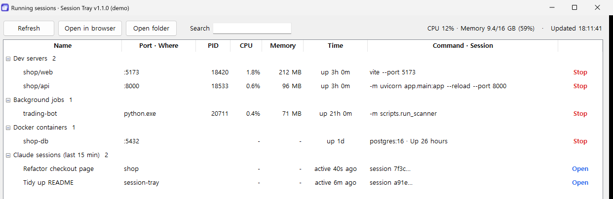

<p align="center">
  
</p>

<h1 align="center">Session Tray</h1>

<p align="center"><a href="README.md">한국어</a> · <b>English</b></p>

<p align="center">
  One icon in the taskbar or menu bar shows<br>
  <b>the dev servers, background jobs, Docker containers and Claude Code sessions running on your computer</b>, with CPU and memory.
</p>

<p align="center">
  <a href="https://github.com/Eehnodu/session-tray/releases/latest"></a>
  
  
  
  <a href="LICENSE"></a>
</p>

<p align="center">
  
</p>

---

## When it helps

- You have several terminals open and lose track of **which project's server is on which port**
- A `node` or `python` you thought you closed is **still running and eating memory**
- You run several Claude Code sessions and want to see **which folder each one is working in**
- You want to know **right away when a server you left running dies**

## Features

| | |
|---|---|
| **Dev servers** | node, python, java and others that listen on a port, with project name and port |
| **Background jobs** | Scripts without a port (bots, scanners, workers), grouped separately |
| **Docker containers** | Running containers with ports and image (only if you use Docker) |
| **Claude Code sessions** | Sessions with activity in the last 15 minutes, with title and folder. **Open** resumes one in the Claude app |
| **Usage** | CPU % and memory per item (children included), plus whole-computer usage at the top |
| **Search** | Type a project name, port or command in the search box to filter instantly |
| **Quick actions** | Open in browser, open folder, red **Stop** at the end of each row (asks first, stops only that item) |
| **Alerts** | When a server, job or container stops, or when one item uses a lot of memory (2 GB by default) |
| **Update alert** | Tells you when a new version is out; get it from the icon menu |
| **Icon status** |  no dot = nothing running · green = servers or containers · orange = jobs only |
| **Language and look** | Korean and English (follows your system language), Windows dark mode, remembers window size and position |

## Install

### Windows

1. **[Download SessionTray-windows.exe](https://github.com/Eehnodu/session-tray/releases/latest/download/SessionTray-windows.exe)**. Python is not needed.
2. Put the file in any folder (for example `Documents\SessionTray`) and double-click it
   - If "Windows protected your PC" appears, click **More info → Run anyway** (it appears because this personal project is not code-signed)
3. Find the indigo icon under the **`^` (hidden icons)** arrow at the right of the taskbar
4. **Right-click the icon → Show sessions**
5. To start it with your computer, right-click → **Start with Windows**

### macOS

On a Mac there is no installer: you put one app file in a folder and that's it.

1. **Download**: **[Download SessionTray-macos.zip](https://github.com/Eehnodu/session-tray/releases/latest/download/SessionTray-macos.zip)**. It is saved to your **Downloads** folder (the Downloads stack in the Dock, or "Downloads" in the Finder sidebar)
2. **Unzip**: double-click the zip file and a `Session Tray` app appears next to it. If you used Safari it may already be unzipped
3. **Move it to Applications** (recommended): drag `Session Tray` onto **Applications** in the Finder sidebar. You will then also find it in Launchpad. Running it straight from Downloads works too
4. **First launch**: double-click `Session Tray`. The first time, macOS blocks it, because the app is not notarized by Apple (most small apps from the internet are like this)
   - When **"Apple could not verify 'Session Tray' is free of malware"** appears, click **Done** (or OK)
   - Go to **System Settings → Privacy & Security**, and next to **"Session Tray" was blocked** near the bottom, click **Open Anyway** → your Mac password → **Open**
   - On macOS 14 (Sonoma) or earlier, you can also **right-click `Session Tray` → Open → Open**
   - After the first time, a normal double-click opens it
5. **Use it**: click the new icon in the **menu bar** at the top of the screen (left of the clock) and choose **Show sessions**
6. To start it automatically every time you log in: icon menu → **Open at login**

## Run from source

You need Python 3.10 or later and git. `uv` makes it faster if you have it.

```powershell
# Windows
git clone https://github.com/Eehnodu/session-tray.git
cd session-tray
powershell -ExecutionPolicy Bypass -File install.ps1
```

```bash
# macOS
git clone https://github.com/Eehnodu/session-tray.git
cd session-tray
bash install.sh
```

Both scripts create a virtual environment, install the dependencies (`pystray`, `psutil`, `Pillow`) and start the tray. Running one again stops the running tray and starts a fresh one, so to update, `git pull` and run it again.

| Command | What it does |
|---|---|
| `python session_tray.pyw` | Start the tray (on Windows, `pythonw` starts it without a console window) |
| `python session_tray.pyw --window --demo` | Open only the window, with demo data (add `--lang=en`, `--light` or `--dark` if you like) |
| `python session_tray.pyw --selftest` | Check without a screen (reading the list, icon, tkinter) |

## How to use

- **Right-click the icon → Show sessions** (on Windows, double-clicking the icon does the same). The window refreshes every 5 seconds
- Red **Stop** at the end of a server or job row → after you confirm, stops only that process and its children. For containers it runs `docker stop`
- Blue **Open** at the end of a Claude session row → opens that conversation in the Claude desktop app
- **Right-click a row** (Control+click on macOS): Open in browser, Open folder, Open in Claude, Stop
- **Double-click a row**: a server opens in the browser, a Claude session opens in the Claude app, anything else opens its folder
- **Search** box at the top: filters as you type (Esc clears it)
- Hover over the icon to see the counts and whole-computer usage
- Icon menu **Notify when something stops**: turns stop alerts on or off (items you stop from the window are not reported)
- Icon menu **Quit tray**: closes only this app (your servers and jobs keep running)

## Settings

Icon menu → **Open settings file** opens the settings file in Notepad (TextEdit on a Mac). Save it and the change applies right away (the window picks it up the next time it opens).

| Key | Default | Meaning |
|---|---|---|
| `language` | `"auto"` | Set `"ko"` or `"en"` to fix the language |
| `extra_roots` | `[]` | More folders where you keep projects, for example `["D:/code", "~/work"]` |
| `active_minutes` | `15` | Show Claude sessions with activity within this many minutes |
| `refresh_seconds` | `5` | How often the window refreshes |
| `notify_on_stop` | `true` | Stop alerts |
| `memory_alert_mb` | `2048` | Alert when one item uses more than this many MB (at most once an hour; `0` turns it off) |
| `check_updates` | `true` | Check for a new version once a day (only asks GitHub for the latest version number) |

## What it detects

| Group | Rule |
|---|---|
| Dev servers | node, python, java, deno, bun, ruby, php or go listening on a port from 1024 to 49151 |
| Background jobs | Running from your user folders (`~/dev`, `~/source/repos`, `~/projects`, `~/Documents`, `~/Desktop` and so on) without a port |
| Docker containers | Whatever `docker ps` lists. If Docker is missing or not running, the group is hidden |
| Claude Code sessions | Conversation logs in `~/.claude/projects` changed within the last 15 minutes. The name is your renamed title, otherwise the automatic title |

- Child processes doing the same job (a `.venv` launcher → the real python, `npm` → `vite` and so on) are folded into one row, with ports and usage combined
- Internal tools of editors and apps (AppData, `~/Library`, `/Applications`, `.vscode` and so on) are left out
- Everything is read on your computer and sent nowhere (the update check only asks GitHub for the latest version number)

## Troubleshooting

| Problem | What to check |
|---|---|
| No icon | Windows: look inside the `^` hidden icons (you can drag it out onto the taskbar) |
| Window doesn't open or closes suddenly | The last error is saved to Windows `%LOCALAPPDATA%\session-tray\session_tray.log`, macOS `~/Library/Application Support/session-tray/session_tray.log` |
| A server isn't listed | Without a port and started outside your user folders, it isn't shown. Add that folder to `extra_roots` in the settings |
| **Open** on a Claude session does nothing | The Claude desktop app needs to be installed |
| No alerts | Windows: Settings → System → Notifications, and check that notifications for Python (or SessionTray) are on |
| macOS says the app "is damaged and can't be opened" | That was a problem in 1.0.0. Download the [latest version](https://github.com/Eehnodu/session-tray/releases/latest) again. If it still happens, run `xattr -cr "/Applications/Session Tray.app"` in Terminal and open it again |
| tkinter error on macOS | With Homebrew python, `brew install python-tk`, or use the python.org installer |

## Release notes

| Version | Date | Changes |
|---|---|---|
| 1.1.1 | 2026-10-15 | Fixed leftover pieces like `exe -m …` in the command column, and Docker not being found by the macOS app opened from Finder or by a tray started before Docker was installed |
| 1.1.0 | 2026-10-15 | Docker containers, **Open** for Claude sessions, stop and memory alerts, search, update alert, English UI, Windows dark mode, remembered window size and position, settings file |
| 1.0.1 | 2026-10-15 | macOS: fixed "is damaged and can't be opened" by re-signing the app after the build step that broke its signature, and checking it |
| 1.0.0 | 2026-10-15 | First public release: dev servers, background jobs and Claude Code sessions, per-item CPU and memory plus whole-computer usage, Stop and right-click menu on each row, start at login, Windows executable and macOS app |

## License

[MIT](LICENSE). Free to use and modify.
