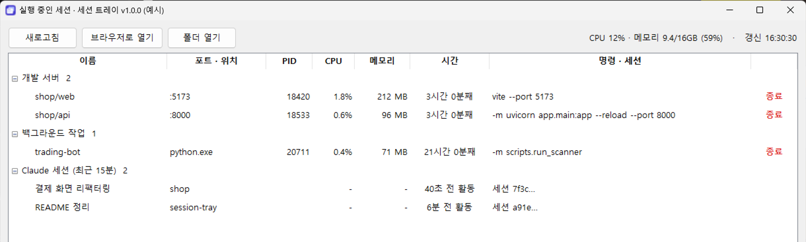

<p align="center">
  
</p>

<h1 align="center">세션 트레이</h1>

<p align="center">
  작업 표시줄 · 메뉴 막대 아이콘 하나로<br>
  <b>지금 내 PC 에서 돌아가는 개발 서버 · 백그라운드 작업 · Claude Code 세션</b>과 CPU · 메모리를 한눈에.
</p>

<p align="center">
  <a href="https://github.com/Eehnodu/session-tray/releases/latest"></a>
  
  
  
  <a href="LICENSE"></a>
</p>

<p align="center">
  
</p>

---

## 이런 때 씁니다

- 터미널을 여러 개 띄워 두다 보니 **어느 프로젝트의 서버가 몇 번 포트에 떠 있는지** 헷갈릴 때
- 끈 줄 알았던 `node` · `python` 이 뒤에서 계속 돌며 **메모리를 먹고 있을 때**
- Claude Code 세션을 여러 개 열어 두고 **지금 어느 폴더에서 무슨 작업이 돌아가는지** 보고 싶을 때

## 할 수 있는 것

| | |
|---|---|
| **개발 서버** | 포트를 열고 있는 node · python · java 등을 프로젝트 이름 · 포트와 함께 보여 줍니다 |
| **백그라운드 작업** | 포트 없이 도는 스크립트(봇 · 스캐너 · 워커)도 따로 모아 보여 줍니다 |
| **Claude Code 세션** | 최근 15분 안에 대화가 오간 세션을 제목 · 폴더와 함께 보여 줍니다 |
| **사용량** | 항목마다 CPU % · 메모리(자식 프로세스 포함), 위쪽에 PC 전체 사용량 |
| **바로 동작** | 브라우저로 열기 · 폴더 열기 · 줄 끝 빨간 **종료**(확인 후 그 프로세스만) |
| **아이콘 상태** |  점 없음 = 아무것도 안 돎 · 초록 = 서버 있음 · 주황 = 작업만 |

## 받아서 쓰기 (개발 몰라도 됨)

### Windows

1. **[SessionTray-windows.exe 내려받기](https://github.com/Eehnodu/session-tray/releases/latest/download/SessionTray-windows.exe)**
2. 내려받은 파일을 원하는 폴더(예: `문서\세션트레이`)에 두고 더블클릭
   - "Windows의 PC 보호" 창이 뜨면 **추가 정보 → 실행** (개인 개발 프로그램이라 서명이 없어서 뜹니다)
3. 작업 표시줄 오른쪽 **`^`(숨김 아이콘)** 에서 남색 아이콘을 찾습니다
4. 아이콘 **우클릭 → 세션 보기**
5. 컴퓨터를 켤 때마다 띄우려면 우클릭 → **윈도우 시작 시 실행**

### macOS (시험판)

1. **[SessionTray-macos.zip 내려받기](https://github.com/Eehnodu/session-tray/releases/latest/download/SessionTray-macos.zip)** → 압축을 풀어 `Session Tray.app` 을 `응용 프로그램` 폴더로
2. 처음 한 번은 **우클릭 → 열기 → 열기** (애플 개발자 서명이 없어 더블클릭으로는 "확인되지 않은 개발자"라며 막힙니다)
   - **"손상되었기 때문에 열 수 없습니다"** 가 뜨면 터미널에서 아래를 실행한 뒤 다시 엽니다(인터넷에서 받은 파일 표시를 지움)
     ```bash
     xattr -cr "/Applications/Session Tray.app"
     ```
3. 화면 위 **메뉴 막대**에서 아이콘을 찾아 **세션 보기**
4. 로그인할 때마다 띄우려면 아이콘 메뉴 → **로그인 시 실행**

> macOS 판은 자동 빌드 머신에서 실행 · 목록 읽기까지만 확인했고, 실제 맥에서 눈으로 확인하는 중입니다. 이상하면 [이슈](https://github.com/Eehnodu/session-tray/issues)로 알려 주세요.

## 소스로 쓰기 (개발자)

필요한 것: Python 3.10 이상, git. `uv` 가 있으면 더 빠릅니다.

```powershell
# Windows
git clone https://github.com/Eehnodu/session-tray.git
cd session-tray
powershell -ExecutionPolicy Bypass -File install.ps1
```

```bash
# macOS
git clone https://github.com/Eehnodu/session-tray.git
cd session-tray
bash install.sh
```

두 스크립트 모두 가상환경 · 의존성(`pystray` · `psutil` · `Pillow`)을 설치하고 트레이를 띄웁니다. 다시 실행하면 떠 있는 트레이를 끄고 새로 띄우므로, 업데이트는 `git pull` 뒤 한 번 더 실행하면 됩니다.

| 명령 | 하는 일 |
|---|---|
| `python session_tray.pyw` | 트레이 띄우기(Windows 는 `pythonw` 로 띄우면 콘솔 창이 없습니다) |
| `python session_tray.pyw --window --demo` | 예시 데이터로 창만 띄우기 |
| `python session_tray.pyw --selftest` | 화면 없이 점검(목록 읽기 · 아이콘 · tkinter) |

## 쓰는 법

- 아이콘 **우클릭 → 세션 보기**(Windows 는 아이콘 더블클릭도 같다). 창은 5초마다 새로 읽습니다
- 서버 · 작업 줄 끝의 빨간 **종료** → 확인하면 그 프로세스와 자식만 끕니다. Claude 세션은 Claude 에서 닫으세요
- 줄 **우클릭**(macOS 는 Control+클릭): 브라우저로 열기 · 폴더 열기 · 종료
- 줄 **더블클릭**: 서버면 브라우저로, 아니면 폴더를 엽니다
- 아이콘에 마우스를 올리면 개수와 PC 전체 사용량이 보입니다
- 아이콘 메뉴 **트레이 끄기**: 이 프로그램만 끕니다(돌던 서버 · 작업은 그대로)

## 어떻게 찾나

| 구분 | 기준 |
|---|---|
| 개발 서버 | node · python · java · deno · bun · ruby · php · go 가 1024 ~ 49151 포트를 열고 있음 |
| 백그라운드 작업 | 사용자 폴더 아래(`~/dev` · `~/source/repos` · `~/projects` · `~/Documents` · `~/Desktop` 등)에서 도는데 포트가 없음 |
| Claude Code 세션 | `~/.claude/projects` 의 대화 기록이 최근 15분 안에 바뀜 — 이름은 바꾼 제목, 없으면 자동 제목 |

- 같은 일을 하는 자식 프로세스(`.venv` 런처 → 실제 python, `npm` → `vite` 등)는 한 줄로 묶고, 포트 · 사용량은 합쳐서 보입니다
- 편집기 · 앱 내부 도구(AppData · `~/Library` · `/Applications` · `.vscode` 등)는 뺍니다
- 모든 정보는 내 PC 안에서만 읽고, 어디로도 보내지 않습니다

## 문제가 생기면

| 증상 | 확인 |
|---|---|
| 아이콘이 안 보임 | Windows: `^` 숨김 아이콘 안을 보세요(끌어서 작업 표시줄로 꺼낼 수 있습니다) |
| 창이 안 뜸 · 갑자기 꺼짐 | 마지막 오류가 남습니다 — Windows `%LOCALAPPDATA%\session-tray\session_tray.log`, macOS `~/Library/Application Support/session-tray/session_tray.log` |
| 서버가 목록에 없음 | 사용자 폴더 밖에서 띄웠고 포트도 없으면 안 보입니다 |
| macOS 에서 tkinter 오류 | Homebrew python 이면 `brew install python-tk`, 또는 python.org 설치본 사용 |

## 버전

| 버전 | 날짜 | 바뀐 것 |
|---|---|---|
| 1.0.1 | 2026-10-15 | macOS: 앱이 "손상되었기 때문에 열 수 없습니다"로 막히던 것 — 빌드 때 깨진 서명을 다시 붙이고 검사 |
| 1.0.0 | 2026-10-15 | 첫 공개 — 개발 서버 · 백그라운드 작업 · Claude Code 세션, 항목별 CPU · 메모리와 PC 전체 사용량, 줄마다 종료 · 우클릭 메뉴, 시작 시 자동 실행, Windows 실행 파일 · macOS 앱(시험판) |

## 라이선스

[MIT](LICENSE) — 자유롭게 받아 쓰고 고쳐 써도 됩니다.
